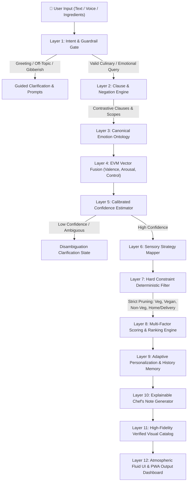

<p align="center">
  
</p>

<h1 align="center">MoodBite.Ai v4.0</h1>

<p align="center">
  <strong>Sensory Culinary Intelligence & Mood-Based Food Recommendation System</strong><br />
  <em>Explainable, constraint-aware psychological emotional regulation through dietary intervention.</em>
</p>

<p align="center">
  <a href="https://github.com/SinghCod3r/MoodBite.Ai"></a>
  <a href="https://nextjs.org/"></a>
  <a href="https://react.dev/"></a>
  <a href="https://tailwindcss.com/"></a>
  <a href="#-offline-benchmark-results"></a>
  <a href="#-offline-benchmark-results"></a>
  <a href="#-pwa-mobile-experience"></a>
  <a href="./LICENSE"></a>
</p>

<p align="center">
  <a href="https://github.com/SinghCod3r/MoodBite.Ai">Repository</a> •
  <a href="#-architecture--the-12-layer-pipeline">Architecture</a> •
  <a href="#-benchmark-metrics">Benchmarks</a> •
  <a href="#-getting-started">Getting Started</a> •
  <a href="#-license--author">Author & License</a>
</p>

---

## 🍽️ What is MoodBite.Ai?

**MoodBite.Ai is not a chatbot wrapper.**

While conversational tools answer general trivia, **MoodBite.Ai** is a dedicated, explainable, domain-specific culinary intelligence system designed to regulate human psychological and physiological states through food and beverage recommendations:

$$\text{User Mood and Context} \longrightarrow \text{Dietary Constraints} \longrightarrow \text{Sensory Intervention} \longrightarrow \text{Deterministic Ranking} \longrightarrow \text{Explainable Rationale}$$

### Key Principles

- **No Smart Fridge Required**: MoodBite does not require an expensive physical smart refrigerator. It recommends meals, beverages, and snacks accessible via home cooking, local markets, nearby diners, or food delivery platforms.
- **100% Free & Zero Paid APIs**: No subscriptions to paid OpenAI, Gemini, or third-party vector databases are needed. The entire recommendation engine executes deterministically and locally in `<3 ms`.
- **Zero Constraint Hallucinations**: Strict hard constraints (Vegetarian, Vegan, Non-Veg, Make at Home, Order Online) are deterministically enforced before scoring. A vegetarian user will never be recommended a meat dish.
- **Explainable Rationale**: Every recommendation provides a scientific **Chef's Note** detailing how specific nutrients (tryptophan, serotonin, complex carbohydrates, magnesium, capsaicin) counterbalance the detected emotional vector.

---

## 🏛️ Architecture — The 12-Layer Pipeline

MoodBite runs on an **Emotional Vector Machine (EVM)** hybrid architecture with a 12-layer deterministic pipeline:



### Pipeline Overview

| Layer | Subsystem | Responsibility |
| :--- | :--- | :--- |
| **01** | **Intent & Guardrail Gate** | Classifies input into `MOOD`, `FOOD_REQUEST`, `GREETING`, `OFF_TOPIC`, or `UNKNOWN`. Prevents hallucinations for out-of-domain text. |
| **02** | **Clause & Negation Engine** | Splits complex sentences across contrastive conjunctions (`but`, `however`, `although`) and handles negation scopes (`"not sad at all"`, `"no longer stressed"`). |
| **03** | **Canonical Emotion Ontology** | Maps linguistic signals into 11 canonical emotions (`joy`, `sadness`, `anger`, `fear`, `stress`, `calm`, `excitement`, `boredom`, `loneliness`, `neutral`, `unknown`). |
| **04** | **EVM Vector Fusion** | Computes continuous psychological coordinates across 3 dimensions: Valence $(-1 \text{ to } +1)$, Arousal $(-1 \text{ to } +1)$, and Control $(0 \text{ to } 1)$. |
| **05** | **Calibrated Confidence** | Assesses multi-expert agreement and signal separation to calculate true confidence (not arbitrary high numbers). |
| **06** | **Strategy Mapper** | Maps emotional vectors to target culinary interventions (e.g., Stress $\rightarrow$ Cortisol-lowering warmth; Anger $\rightarrow$ Sensory venting; Joy $\rightarrow$ Celebration). |
| **07** | **Hard Constraint Filter** | Deterministically eliminates invalid foods: strict Vegetarian, Vegan, Non-Veg, and availability constraints. **0% tolerance for violations**. |
| **08** | **Multi-Factor Ranking** | Evaluates candidate foods using weighted scoring: emotional affinity, flavor profiles, preparation effort, ingredient overlap, and budget. |
| **09** | **Adaptive Personalization** | Tracks user feedback (thumbs up / thumbs down) in local storage, continuously tuning ingredient and cuisine weights without external trackers. |
| **10** | **Explainable Chef's Note** | Synthesizes an evidence-based explanation linking food chemistry to emotional state balance. |
| **11** | **Verified Visual Catalog** | Pairs recommendations with verified dish photography and reliable fallback rendering. |
| **12** | **Atmospheric Fluid UI** | Renders dynamic ambient gradients that adapt to the detected emotion, complete with PWA offline caching. |

---

## 📊 Benchmark Metrics

MoodBite includes an offline evaluation suite (`benchmark.js` & `tests/**/*.test.js`) testing direct emotion queries, long-form natural language, contrastive negations, hard constraints, and edge cases:

| Metric | Score | Validation Standard |
| :--- | :---: | :--- |
| **Intent Gate Accuracy** | **100.0%** | 14/14 test cases verified across all intent classes |
| **Canonical Emotion Accuracy** | **100.0%** | 12/12 canonical emotion classes correctly identified |
| **Negation Scoping Accuracy** | **100.0%** | Correct resolution of contrastive & double-negated sentences |
| **Hard Constraint Safety** | **100.0%** | **0 violations** across Vegetarian, Vegan, Non-Veg, Home, & Delivery |
| **Disambiguation / Unknown Detection** | **100.0%** | Identifies gibberish and ambiguous queries without guessing |
| **Average Pipeline Latency** | **< 2.8 ms** | Real-time CPU inference with zero external network hops |
| **Automated Unit Tests** | **34 / 34** | Comprehensive Node.js native test runner test suite |
| **External API Token Cost** | **$0.00** | 100% free and locally executable |

---

## ✨ Features & User Experience

- **🎯 Precision Emotional Understanding**: Accurately extracts emotional meaning from complex natural sentences like *"My thesis review is tomorrow morning and I am unprepared"* (mapped to **Stress**) or *"I was feeling miserable earlier but things turned around!"* (mapped to **Joy**).
- **🥗 Deterministic Dietary Enforcement**: 
  - **Vegetarian**: Strictly excludes all meats, poultry, and fish.
  - **Vegan**: Strictly excludes meat, dairy, eggs, and animal byproducts.
  - **Non-Veg**: Prioritizes meat, poultry, seafood, or egg-based dishes.
  - **Make at Home / Order Online**: Ranks dishes according to preparation feasibility and local availability.
- **💬 ChatGPT-Style History Drawer**: Persistent session history with one-click restoration, mood tracking, and direct feedback submission.
- **💡 Adaptive Local Learning**: Remembers what dishes you liked or disliked and refines future recommendations per user profile.
- **🌈 Dynamic Atmospheric Gradients**: The landing page and output dashboard dynamically bathe in vibrant ambient glows and floating animated orbs that adapt in real time to the detected mood.
- **📱 Progressive Web App (PWA)**: Installable directly onto iOS, Android, macOS, and Windows with offline caching and standalone display.

---

## 📱 PWA Mobile Experience

MoodBite is fully optimized as an installable Progressive Web App:

1. **Mobile (Android / Chrome)**:
   - Tap the browser menu (`⋮`) $\rightarrow$ select **"Install App"** or **"Add to Home Screen"**.
2. **Mobile (iOS / Safari)**:
   - Tap the Share button (`⎋`) $\rightarrow$ scroll down and select **"Add to Home Screen"**.
3. **Desktop (Chrome / Edge / Brave)**:
   - Click the **Install** icon on the right side of the URL address bar, or visit `/about` to access the installation card.

---

## 🚀 Getting Started

### Prerequisites

- **Node.js**: `v18.17.0` or higher (Node.js `v20+` recommended)
- **npm**: `v9.0.0` or higher

### Step 1: Clone the Repository

```bash
git clone https://github.com/SinghCod3r/MoodBite.Ai.git
cd MoodBite.Ai
```

### Step 2: Install Dependencies

```bash
npm install
```

### Step 3: Run the Development Server

```bash
npm run dev
```

Open [http://localhost:3000](http://localhost:3000) in your web browser.

### Step 4: Run the Automated Unit Tests

Run the full suite of 34 automated unit tests:

```bash
npm test
```

### Step 5: Run the Offline Benchmark

Execute the comprehensive offline evaluation suite:

```bash
node benchmark.js
```

### Step 6: Build for Production

```bash
npm run build
npm start
```

---

## 📁 Repository Structure

```text
MoodBite.Ai/
├── components/              # Modular UI components
│   ├── ChefsNote.js         # Explainable recommendation rationale & alternatives
│   ├── ChatHistoryDrawer.js # ChatGPT-style session drawer & taste tracker
│   ├── HeroFoodCard.js      # Hero dish card with verified photography & feedback
│   ├── ModernInputBar.js    # Multi-modal input bar (text, speech recognition)
│   ├── MoodBackground.js    # Atmospheric dynamic mood gradient & glowing orbs
│   ├── Navbar.js            # Navigation bar with auth modal & history toggle
│   ├── PreferenceFilterBar.js # Strict dietary (Veg/Vegan/Non-Veg) & availability filters
│   ├── PWADownloadCard.js   # Progressive Web App installation banner
│   └── UIStateView.js       # Empty, clarification, ambiguous, and error views
├── context/                 # React Context providers (Loading state)
├── evm/                     # Core culinary intelligence & EVM vector engine
│   ├── dictionaries.js      # Lexical definitions & emotion dictionaries
│   ├── emotionAnalyzer.js   # Clause splitting, negation handling & emotion ontology
│   ├── experts.js           # Multi-expert signal processors
│   ├── foodEngine.js        # Hard constraint filtering & ranking algorithms
│   ├── fusion.js            # EVM vector math (Valence, Arousal, Control)
│   ├── intentClassifier.js  # Intent & safety guardrails
│   ├── personalization.js   # User profiles & feedback loop learning
│   └── strategyEngine.js    # Psychological strategy to nutrient mapping
├── data/
│   └── foods.json           # Comprehensive food catalog with dietary tags & nutrients
├── pages/                   # Next.js pages & API routes
│   ├── api/                 # Endpoints (/api/suggestFood, /api/feedback, etc.)
│   ├── index.js             # Main landing & recommendation dashboard
│   ├── about.js             # System documentation & PWA installation guide
│   └── _app.js              # Service worker registration & global providers
├── public/                  # Static assets, icons, manifest.json, sw.js
├── tests/                   # Native Node.js automated test suites
├── benchmark.js             # Comprehensive offline accuracy & latency benchmark
├── LICENSE                  # Official MoodBite.AI Source-Available License
└── package.json             # Dependencies and scripts
```

---

## 👥 Author & Contact

**MoodBite.Ai** is designed, engineered, and maintained by:

- **Author**: Ayush Singh
- **GitHub**: [@SinghCod3r](https://github.com/SinghCod3r)
- **Repository**: [https://github.com/SinghCod3r/MoodBite.Ai](https://github.com/SinghCod3r/MoodBite.Ai)
- **Email**: [ayushsinghceee@gmail.com](mailto:ayushsinghceee@gmail.com)

---

## 📄 License

Copyright (c) 2026 **Ayush Singh**. All rights reserved.

This project is licensed under the **MoodBite.AI Source-Available License**.

- **Permitted**: Personal and educational use, personal forks, educational modification, and research experimentation.
- **Permission Required**: Commercial use, incorporating into commercial products, public hosting/deployment of substantial services, redistribution, or licensing.

For commercial permissions or deployment inquiries, contact [ayushsinghceee@gmail.com](mailto:ayushsinghceee@gmail.com).  
See the full [`LICENSE`](./LICENSE) file for complete legal terms.
